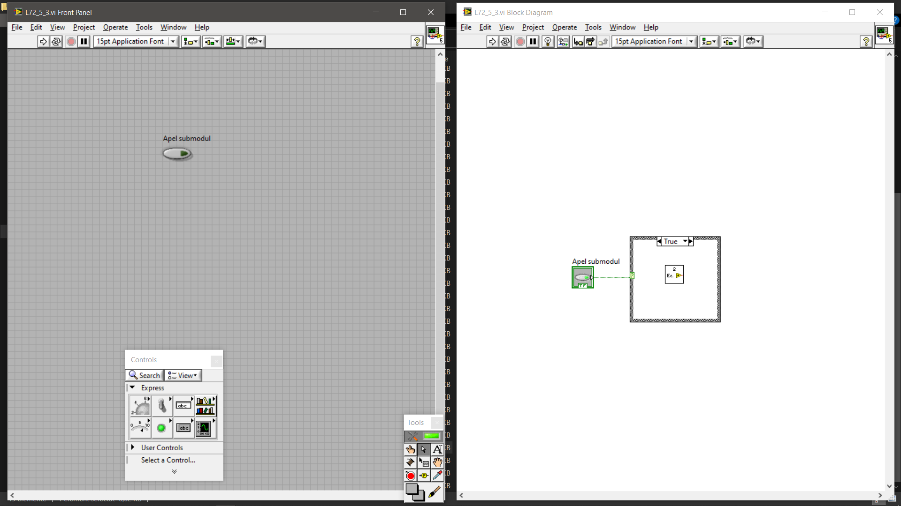
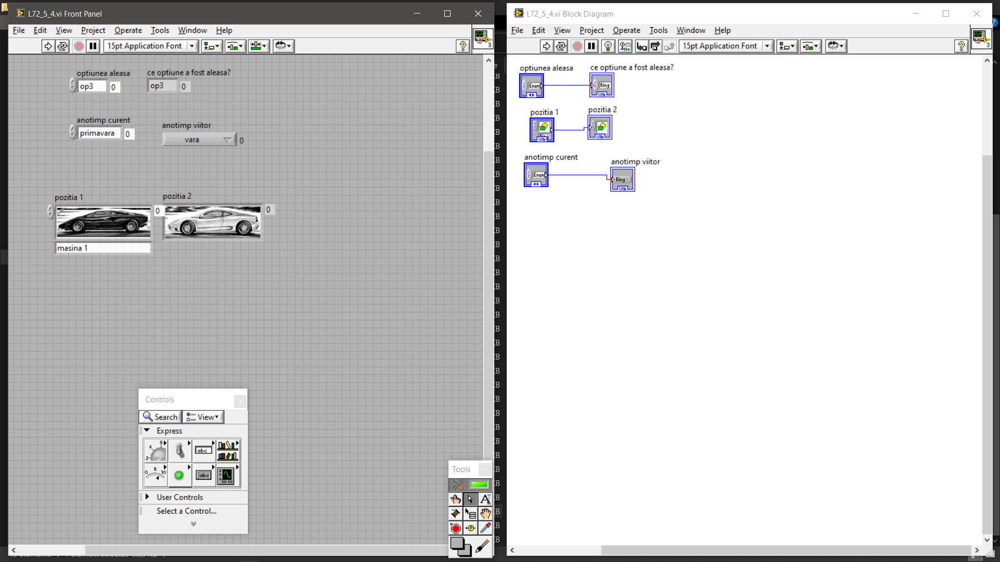
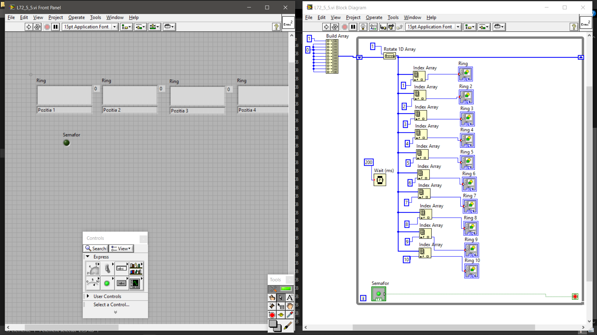

# LabVIEW – Programare modulară și prelucrarea datelor

---

# 🇷🇴 Română

## 1. Descrierea proiectului

Acest proiect conține trei aplicații dezvoltate în NI LabVIEW, concepute pentru implementarea și explorarea unor concepte fundamentale de programare vizuală. Proiectul urmărește implementarea unor operații precum apelarea unui subVI, selectarea și afișarea unor opțiuni și rotirea elementelor unui tablou.

Aplicațiile abordează trei direcții tehnice:

- Programare modulară prin apelarea unui subVI și controlul execuției cu o structură Case.
- Selectarea și transmiterea valorilor între controale Enum și indicatoare Ring.
- Construirea, rotirea și indexarea unui tablou unidimensional, cu actualizarea repetată a valorilor într-o structură While Loop.

Fiecare aplicație include implementarea grafică (Block Diagram) și interfața de utilizare (Front Panel).

## 2. Structura proiectului

```text
LabVIEW–Programare-modulara-si-prelucrarea-datelor/
│
├── aplicatii/
│   ├── L72_5_3.vi
│   ├── L72_5_4.vi
│   └── L72_5_5.vi
│
├── capturi/
│   ├── L7-2-3.png
│   ├── L7-2-4.png
│   └── L7-2-5.png
│
└── README.md
```

## 3. Aplicații și detalii de implementare

### 3.1. Apelarea unui subVI printr-o structură Case

**Fișier:** `L72_5_3.vi`

**Obiectiv:** Implementarea unui mecanism de control condițional pentru executarea unui subVI.

**Implementare tehnică:**

- Utilizarea unui Boolean Control ca intrare pentru selectorul unei structuri Case.
- Configurarea structurii Case pentru evaluarea condiției booleene.
- Plasarea unui subVI în cazul `True`.
- Controlul execuției subVI-ului în funcție de valoarea selectorului.

**Flux de execuție:**

1. Utilizatorul modifică starea controlului boolean.
2. Valoarea booleană este transmisă selectorului structurii Case.
3. Structura selectează cazul corespunzător.
4. În cazul `True`, este executat apelul subVI-ului.

**Concepte LabVIEW demonstrate:**
- Boolean Controls
- Case Structures
- SubVI Calls
- Modular Programming
- Dataflow Programming

**Front Panel și Block Diagram:**



### 3.2. Selectarea opțiunilor și transferul valorilor între controale

**Fișier:** `L72_5_4.vi`

**Obiectiv:** Implementarea selecției unor valori discrete și transmiterea acestora către indicatoare pentru reprezentare vizuală.

**Implementare tehnică:**

Aplicația utilizează controale Enum și Ring pentru selectarea și reprezentarea unor valori discrete.

Block Diagram-ul prezintă conexiuni directe între terminalele controalelor și indicatoare, realizate prin intermediul firelor de date LabVIEW.

Sunt implementate trei grupuri de selecție:

- **Selecția opțiunii:** o valoare Enum este transmisă către un indicator Ring.
- **Selecția anotimpului curent:** valoarea selectată este reprezentată printr-un control Enum.
- **Selectarea anotimpului viitor:** valoarea corespunzătoare este transmisă către un indicator Ring.

Interfața Front Panel include și două poziții pentru afișarea imaginilor asociate opțiunilor selectate.

**Concepte LabVIEW demonstrate:**
- Enum Controls
- Ring Controls
- Numeric Representation
- Dataflow Connections
- Front Panel Indicators
- Visual Data Representation

**Front Panel și Block Diagram:**



### 3.3. Manipularea și rotirea unui tablou unidimensional

**Fișier:** `L72_5_5.vi`

**Obiectiv:** Implementarea unui mecanism iterativ de manipulare și afișare a elementelor unui tablou unidimensional.

**Implementare tehnică:**

Aplicația utilizează o structură While Loop pentru executarea repetată a operațiilor asupra unui tablou.

Procesarea datelor este realizată prin următoarele etape:

1. **Inițializarea tabloului:** funcția `Build Array` construiește un tablou unidimensional din constante numerice.
2. **Rotirea elementelor:** funcția `Rotate 1D Array` deplasează circular elementele tabloului, utilizând o valoare constantă de deplasare egală cu 1.
3. **Indexarea datelor:** funcțiile `Index Array` extrag elementele de la indicii conectați în diagramă.
4. **Afișarea valorilor:** elementele extrase sunt transmise către zece indicatoare de tip Ring.
5. **Temporizarea execuției:** funcția `Wait (ms)` introduce o întârziere de 200 ms în cadrul buclei.
6. **Controlul opririi:** un Boolean Control conectat la terminalul condițional al buclei permite oprirea execuției.

**Concepte și funcții LabVIEW demonstrate:**
- Build Array
- Rotate 1D Array
- Index Array
- While Loop
- Wait (ms)
- Ring Indicators
- Boolean Control
- Iterative Data Processing
- Array Manipulation

**Front Panel și Block Diagram:**



## 4. Funcționalități și concepte tehnice

| Domeniu | Elemente implementate |
|---|---|
| Programare modulară | SubVI Calls |
| Controlul execuției | Case Structure |
| Tipuri de date | Boolean, Enum, Numeric |
| Reprezentarea datelor | Ring Controls și Indicators |
| Procesarea datelor | Build Array, Index Array |
| Manipularea tablourilor | Rotate 1D Array |
| Execuție iterativă | While Loop |
| Temporizare | Wait (ms) |

## 5. Tehnologii și instrumente

- **NI LabVIEW** – mediu de dezvoltare pentru programare grafică.
- **G Programming** – paradigmă de programare bazată pe diagrame și fluxul datelor.
- **Front Panel** – proiectarea interfeței și reprezentarea valorilor.
- **Block Diagram** – implementarea logicii și a fluxului de execuție.

## 6. Cerințe și dependențe

- Instalarea NI LabVIEW.
- Fișierele aplicațiilor disponibile în directorul `aplicatii/`.
- Dependențele externe necesare fiecărei aplicații trebuie să fie disponibile în mediul LabVIEW.

## 7. Rulare

1. Clonează repository-ul sau descarcă fișierele.
2. Deschide NI LabVIEW.
3. Accesează directorul `aplicatii/`.
4. Deschide fișierul `.vi` dorit.
5. Consultă Front Panel și Block Diagram pentru analiza implementării.
6. Rulează aplicația folosind butonul Run din LabVIEW.

---

# 🇬🇧 English

## 1. Project Overview

This project contains three applications developed in NI LabVIEW, focusing on fundamental concepts of graphical programming and dataflow-based execution. The exercises cover subVI calls, option selection and display, and one-dimensional array manipulation.

The applications cover three main technical areas:

- Modular programming through subVI invocation and conditional execution using a Case Structure.
- Selection and transfer of discrete values between Enum controls and Ring indicators.
- One-dimensional array construction, rotation and indexing, combined with iterative execution using a While Loop.

Each application includes its graphical implementation (Block Diagram) and user interface (Front Panel).

## 2. Repository Structure

```text
LabVIEW–Programare-modulara-si-prelucrarea-datelor/
│
├── aplicatii/
│   ├── L72_5_3.vi
│   ├── L72_5_4.vi
│   └── L72_5_5.vi
│
├── capturi/
│   ├── L7-2-3.png
│   ├── L7-2-4.png
│   └── L7-2-5.png
│
└── README.md
```

## 3. Applications and Technical Implementation

### 3.1. SubVI Invocation Using a Case Structure

**File:** `L72_5_3.vi`

**Objective:** Implement a conditional execution mechanism for calling a subVI.

**Technical Implementation:**

- A Boolean Control is used as the selector input of a Case Structure.
- The Case Structure evaluates the Boolean condition.
- A subVI is placed inside the `True` case.
- SubVI execution is controlled by the selector value.

**Execution Flow:**

1. The user changes the Boolean control state.
2. The Boolean value is passed to the Case Structure selector.
3. The structure evaluates the condition and selects the corresponding case.
4. When the `True` case is selected, the subVI call is executed.

**LabVIEW Concepts:**
- Boolean Controls
- Case Structures
- SubVI Calls
- Modular Programming
- Dataflow Programming

**Front Panel and Block Diagram:**


### 3.2. Option Selection and Value Transfer Between Controls

**File:** `L72_5_4.vi`

**Objective:** Implement discrete value selection and transfer selected values to indicators for visual representation.

**Technical Implementation:**

The application uses Enum and Ring controls to select and represent discrete values.

The Block Diagram contains direct data connections between control and indicator terminals, implemented through LabVIEW dataflow wires.

Three selection groups are implemented:

- **Option selection:** an Enum value is transferred to a Ring indicator.
- **Current season selection:** the selected value is represented using an Enum control.
- **Next season selection:** the corresponding value is transferred to a Ring indicator.

The Front Panel also includes two positions for displaying images associated with the selected options.

**LabVIEW Concepts:**
- Enum Controls
- Ring Controls
- Numeric Representation
- Dataflow Connections
- Front Panel Indicators
- Visual Data Representation

**Front Panel and Block Diagram:**


### 3.3. One-Dimensional Array Manipulation and Rotation

**File:** `L72_5_5.vi`

**Objective:** Implement an iterative mechanism for manipulating and displaying the elements of a one-dimensional array.

**Technical Implementation:**

The application uses a While Loop to repeatedly execute operations on an array.

Data processing consists of the following stages:

1. **Array initialization:** `Build Array` constructs a one-dimensional array from numeric constants.
2. **Array rotation:** `Rotate 1D Array` circularly shifts the array elements using a constant rotation offset of 1.
3. **Data indexing:** `Index Array` functions retrieve elements using the wired index values.
4. **Value display:** the retrieved elements are connected to ten Ring indicators.
5. **Execution timing:** `Wait (ms)` introduces a 200 ms delay inside the loop.
6. **Loop termination:** a Boolean Control is connected to the loop's conditional terminal to allow execution to stop.

**LabVIEW Functions and Concepts:**
- Build Array
- Rotate 1D Array
- Index Array
- While Loop
- Wait (ms)
- Ring Indicators
- Boolean Control
- Iterative Data Processing
- Array Manipulation

**Front Panel and Block Diagram:**


## 4. Technical Features and Concepts

| Category | Implemented Elements |
|---|---|
| Modular Programming | SubVI Calls |
| Execution Control | Case Structure |
| Data Types | Boolean, Enum, Numeric |
| Data Representation | Ring Controls and Indicators |
| Data Processing | Build Array, Index Array |
| Array Manipulation | Rotate 1D Array |
| Iterative Execution | While Loop |
| Timing | Wait (ms) |

## 5. Technologies and Tools

- **NI LabVIEW** – graphical development environment.
- **G Programming** – dataflow-based graphical programming paradigm.
- **Front Panel** – user interface design and value representation.
- **Block Diagram** – implementation of application logic and execution flow.

## 6. Requirements and Dependencies

- NI LabVIEW installation.
- Application files available in the `aplicatii/` directory.
- External dependencies required by each application must be available in the LabVIEW environment.

## 7. How to Run

1. Clone the repository or download the project files.
2. Launch NI LabVIEW.
3. Navigate to the `aplicatii/` directory.
4. Open the desired `.vi` file.
5. Inspect the Front Panel and Block Diagram.
6. Execute the application using the Run button in LabVIEW.

---

## 👤 Autor / Author

**IonutD**
